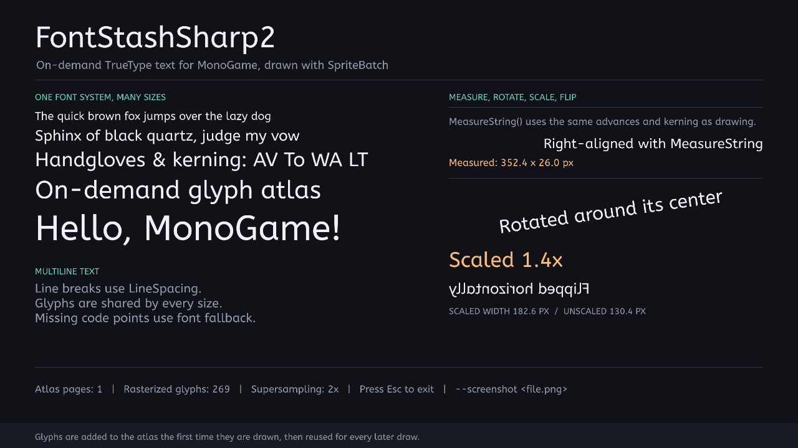

# FontStashSharp2

**On-demand TrueType text rendering for MonoGame and other C# game engines.**

## Overview

FontStashSharp2 parses TTF/OTF fonts with StbTrueTypeNext and rasterizes glyphs into a shared texture
atlas only when they are first needed. The MonoGame package draws with `SpriteBatch` extension methods
that mirror the `SpriteFont` API. The `FontStashSharp2.PlatformAgnostic` package uses renderer
interfaces and an engine-supplied `ITexture2DManager`, so it works without any MonoGame dependency.

`StaticSpriteFont` loads pre-generated AngelCode BMFont atlases through SharpFNT and decodes their page
images with StbImageNext. Static and dynamic fonts share the same draw overloads, effects,
decorations, spacing, and renderer interfaces.

## Why another text library?

- **No content pipeline.** Ship `.ttf`/`.otf` files and load them at runtime, or load AngelCode
  BMFont atlases with `StaticSpriteFont`.
- **On demand.** Measuring text does not touch the GPU; only glyphs that are drawn are rasterized and
  uploaded.
- **Any size, one atlas.** Different font sizes and fallback fonts share one growable atlas.
- **SpriteBatch native.** The familiar `SpriteFont` parameter list, including rotation, origin, scale,
  effects, and layer depth.
- **Engine neutral.** `FontStashSharp2.PlatformAgnostic` exposes renderer interfaces and RGBA texture
  uploads instead of MonoGame types.
- **AOT friendly.** Both class libraries are annotated `IsAotCompatible` and avoid reflection and
  runtime code generation.
- **Sharper scaling.** Glyphs are supersampled 2× by default and drawn at the inverse scale, with a
  configurable factor for heavier zoom.

## Documentation

https://fontstashsharp.github.io/FontStashSharp2

## License

FontStashSharp2 is MIT licensed. The sample/test font **ABeeZee** is licensed under the SIL Open Font
License 1.1; see `THIRD-PARTY-NOTICES.md`.
