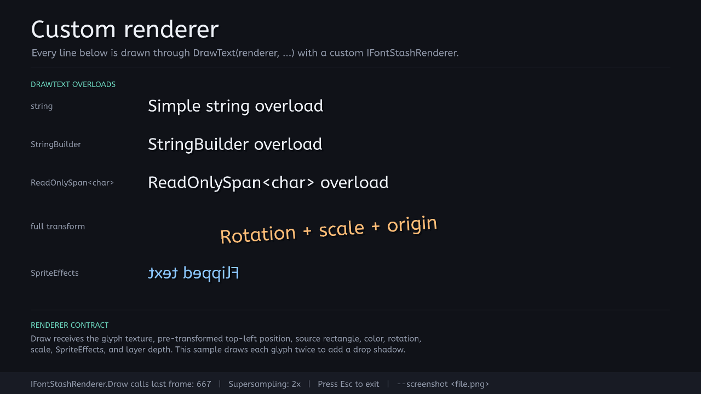

# Custom renderers

Text effects are submitted as extra glyph passes through the same renderer; no renderer changes are
needed. A `null` `TextEffectOptions?` is the only path that uses the optimized SpriteBatch fast path.
See [Text effects](text-effects.md) for the options and effect behavior.

FontStashSharp2 can draw through an arbitrary renderer, not only `SpriteBatch`. The
`IFontStashRenderer` interface receives one glyph quad at a time, with the font's layout, kerning,
supersampling, rotation, scaling, and flip math already applied.

> These interfaces use MonoGame types. For engines without MonoGame, see
> [Platform-agnostic rendering](platform-agnostic.md).

## Interface

```csharp
public interface IFontStashRenderer
{
    GraphicsDevice GraphicsDevice { get; }

    void Draw(
        Texture2D texture,
        Vector2 position,
        Rectangle? sourceRectangle,
        Color color,
        float rotation,
        Vector2 scale,
        SpriteEffects effects,
        float layerDepth);
}
```

The draw contract is intentionally small:

- **position** is the screen-space top-left of the glyph quad.
- **rotation** and **scale** are applied around that top-left (the library uses origin zero).
- **sourceRectangle** is the physical region in the font atlas page.
- **effects** must be honored by mirroring the source UVs; the library uses this for horizontal and
  vertical flips.
- **layerDepth** is passed through unchanged.
- **GraphicsDevice** is the device the renderer submits to.

Textures are owned by the `FontSystem` atlas. Do not dispose or modify them in the renderer.

## SpriteBatch adapter

A minimal adapter is useful when you want the `IFontStashRenderer` code path while still drawing with
`SpriteBatch`:

```csharp
public sealed class SpriteBatchFontRenderer : IFontStashRenderer
{
    private readonly SpriteBatch _spriteBatch;

    public SpriteBatchFontRenderer(GraphicsDevice graphicsDevice, SpriteBatch spriteBatch)
    {
        GraphicsDevice = graphicsDevice;
        _spriteBatch = spriteBatch;
    }

    public GraphicsDevice GraphicsDevice { get; }

    public void Draw(
        Texture2D texture,
        Vector2 position,
        Rectangle? sourceRectangle,
        Color color,
        float rotation,
        Vector2 scale,
        SpriteEffects effects,
        float layerDepth)
    {
        _spriteBatch.Draw(
            texture,
            position,
            sourceRectangle,
            color,
            rotation,
            Vector2.Zero,
            scale,
            effects,
            layerDepth);
    }
}
```

The adapter does not call `Begin`/`End`; the caller controls the batch:

```csharp
var renderer = new SpriteBatchFontRenderer(GraphicsDevice, spriteBatch);
var font = fonts.GetFont(24f);

spriteBatch.Begin(
    blendState: BlendState.AlphaBlend,
    samplerState: SamplerState.LinearClamp);

font.DrawText(renderer, "Custom renderer", new Vector2(40, 40), Color.White);

font.DrawText(
    renderer,
    "Rotated and scaled",
    new Vector2(400, 200),
    Color.White,
    -0.1f,
    font.MeasureString("Rotated and scaled") / 2f,
    new Vector2(1.5f),
    SpriteEffects.None,
    0f);

spriteBatch.End();
```

The dedicated CustomRenderer sample uses exactly this path for all of its text as an end-to-end
visual check.

## DrawText overloads

Every text form has a custom-renderer overload:

```csharp
font.DrawText(renderer, "text", position, color);
font.DrawText(renderer, "text", position, color, rotation, origin, scale, effects, layerDepth);
font.DrawText(renderer, new StringBuilder("text"), position, color);
font.DrawText(renderer, text.AsSpan(), position, color);
```

The shorter forms use rotation `0`, origin `Vector2.Zero`, scale `Vector2.One`,
`SpriteEffects.None`, and layer depth `0`. All overloads eventually call the abstract span hook:

```csharp
public abstract void DrawText(
    IFontStashRenderer renderer,
    ReadOnlySpan<char> text,
    Vector2 position,
    Color color,
    float rotation,
    Vector2 origin,
    Vector2 scale,
    SpriteEffects effects,
    float layerDepth);
```

Custom `SpriteFontBase` implementations must provide this hook, the matching `SpriteBatch` hook, and
the `IFontStashRenderer2` hook described below.

## Vertex-level renderers

`IFontStashRenderer2` is for pipelines that consume vertices directly rather than textured quads:

```csharp
public interface IFontStashRenderer2
{
    GraphicsDevice GraphicsDevice { get; }

    void DrawQuad(
        Texture2D texture,
        ref VertexPositionColorTexture topLeft,
        ref VertexPositionColorTexture topRight,
        ref VertexPositionColorTexture bottomLeft,
        ref VertexPositionColorTexture bottomRight);
}
```

The font supplies:

- screen-space `Position` values;
- `Position.Z` set to the requested layer depth;
- `Color` set to the requested color mask;
- texture coordinates already mirrored for `SpriteEffects`.

A typical implementation submits two triangles using the order
`top-left, top-right, bottom-left` and `top-right, bottom-right, bottom-left`. The same batching and
atlas-page considerations apply as with `IFontStashRenderer`; each `DrawQuad` call includes the texture
that owns its coordinates.

All full and convenience `DrawText` overloads are available for `IFontStashRenderer2` as well.

## Writing a non-SpriteBatch renderer

A renderer backed by another graphics API should submit the quad with the same conventions:

1. Sample the glyph region from the supplied atlas texture.
2. Place its top-left at `position`.
3. Rotate and scale around that top-left.
4. Mirror UVs according to `SpriteEffects`.
5. Apply the supplied color and layer depth in the target pipeline.

Because the font pre-transforms positions, the renderer does not need glyph metrics, kerning, line
layout, or a text origin. This also means batching is the renderer's responsibility: glyphs from
multiple atlas pages will arrive as alternating `Draw` calls in the same order as the text. Group them
by `texture` if your renderer requires it.

The `GraphicsDevice` property is there for renderer resource management and atlas creation.
FontStashSharp2 binds a `FontSystem`'s atlas to the device supplied by the first `SpriteBatch` or
renderer draw/preload. Use a separate `FontSystem` per device.

## Supersampling and effects

The custom-renderer path uses the same supersampling rules as `SpriteBatch`:

- the source rectangle contains the high-resolution glyph;
- `scale` passed to `Draw` is already divided by `SupersamplingFactor`;
- flips mirror the whole text block and set `SpriteEffects` per glyph.

See [Supersampling](supersampling.md) for the factor tradeoffs. Use a filtering sampler/state in the
target renderer when downscaling the supersampled atlas.

## Sample

`Samples/CustomRenderer` demonstrates both interfaces side by side. The left column uses an
`IFontStashRenderer` backed by `SpriteBatch` with a drop shadow; the right column uses an
`IFontStashRenderer2` backed by `BasicEffect`/`DrawUserIndexedPrimitives`. It exercises string,
`StringBuilder`, span, full-transform, and sprite-effects overloads.



```bash
dotnet run --project Samples/CustomRenderer
dotnet run --project Samples/CustomRenderer -- --screenshot custom-renderer.png
```

See [Getting started](../index.md) for the general API, [Samples](samples.md) for the other
samples, and [Architecture](architecture.md) for the rasterization pipeline.

## Related

- [Getting started](../index.md)
- [Architecture](architecture.md)
- [Samples](samples.md)
- [Supersampling](supersampling.md)
- [API reference](xref:FontStashSharp2.IFontStashRenderer)
