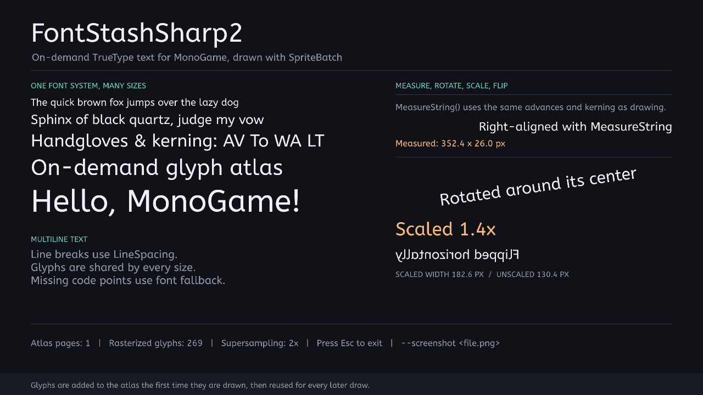
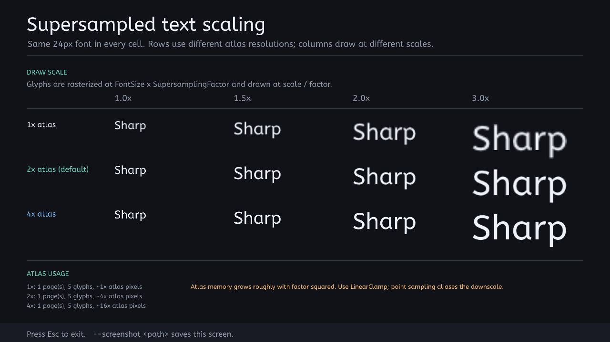

# Samples

The repository contains four samples. The windowed samples also support screenshot modes that double as
integration tests.

## HelloWorld (DesktopGL)

A windowed MonoGame sample showing:

- one `FontSystem` shared by many font sizes,
- `MeasureString`-based right alignment and centered rotation,
- 2× supersampled glyphs for sharper scaled text,
- uniform scaling and horizontal flipping,
- live atlas page, rasterized-glyph, and supersampling counts,
- on-demand glyph caching during draw.



```bash
dotnet run --project Samples/HelloWorld
```

Press `Esc` to exit.

### Screenshot mode

Render a deterministic 1280x720 frame to a PNG and exit:

```bash
dotnet run --project Samples/HelloWorld -- --screenshot out.png
```

This exercises the full path on a real GPU: font parsing, glyph rasterization, atlas upload, padding,
layout, rotation, scaling, flipping, and `SpriteBatch` drawing. It is useful for visual regression
checks on a machine with a display.

## Supersampling (DesktopGL)

A dedicated comparison of glyph-atlas resolutions:

- rows: 1×, 2× (default), and 4× supersampling;
- columns: 1.0×, 1.5×, 2.0×, and 3.0× draw scale;
- the same 24 px font, text, and colors in every cell;
- live atlas page and glyph counts per factor.



```bash
dotnet run --project Samples/Supersampling
dotnet run --project Samples/Supersampling -- --screenshot supersampling.png
```

The 1× row shows magnification blur at 3× display scale. The 4× row stays sharp at 3× because it is
still being downsampled. The 2× row is the default tradeoff. See the
[Supersampling article](supersampling.md) for the full explanation.

## MeasureText (console)

A measurement-only sample that never creates a `GraphicsDevice`:

```bash
dotnet run --project Samples/MeasureText
dotnet run --project Samples/MeasureText -- 48 "Custom text"
```

It prints:

- font name and vertical metrics in font units,
- scaled ascent/descent/line spacing,
- widths and heights for single-line, multi-line, trailing-newline, kerning, and missing-glyph text,
- a centered placement calculation for a 640x360 view,
- cached metric count and the fact that zero glyphs have been rasterized.

This sample is a convenient smoke test for font loading and layout in CI environments without a GPU.

## Benchmark (DesktopGL)

`Samples/Benchmark` compares steady-state `SpriteBatch.DrawString` throughput between
FontStashSharp2 and a regular MonoGame `SpriteFont`. The SpriteFont is built at runtime from the same
TTF and pixel size, so both renderers start with a pre-baked atlas. FontStashSharp2 uses
`SupersamplingFactor = 1` here so both paths draw 1:1 atlases; the HelloWorld sample demonstrates the
default 2× mode. Warmup frames exclude first-use glyph rasterization and JIT. The sample requires a
graphics device/display.

```bash
dotnet run --project Samples/Benchmark
dotnet run --project Samples/Benchmark -- --benchmark
dotnet run --project Samples/Benchmark -- --benchmark --texts 256 --font-size 24 --iterations 200
dotnet run --project Samples/Benchmark -- --screenshot benchmark.png
```

The sample measures two targets:

- **CPU 64×64** — isolates `SpriteBatch` submission/geometry cost by clipping the resulting quads.
- **Full 1280×720** — includes GPU fill and overdraw.

It reports milliseconds per frame, strings/glyph throughput, managed allocations, and a
`SpriteFont / FontStashSharp2` ratio (greater than 1 means FontStashSharp2 is faster).

Useful options:

| Option | Meaning |
| --- | --- |
| `--rounds <n>` | Measured rounds per mode/target. |
| `--iterations <n>` | Frames per measured phase. |
| `--texts <n>` | DrawString calls per frame. |
| `--font-size <n>` | Font size in pixels. |
| `--warmup <n>` | Warmup frames per phase. |
| `--no-kerning` | Disable FontStashSharp2 kerning pairs for diagnostics. |
| `--screenshot <path>` | Save the results screen and exit. |

Numbers vary by CPU/GPU and are intended for comparisons on the same machine. The interactive
results screen includes a visual check drawn by both engines.

## Tests

```bash
dotnet test FontStashSharp2.Tests/FontStashSharp2.Tests.csproj
```

The xUnit suite uses a fake glyph atlas, so it runs without a graphics device. It covers parsing,
fallback order, ASCII coverage, advances, kerning, newlines, tabs, surrogate handling, line spacing,
on-demand caching, preloading, packer edge cases, settings validation, and disposal.
