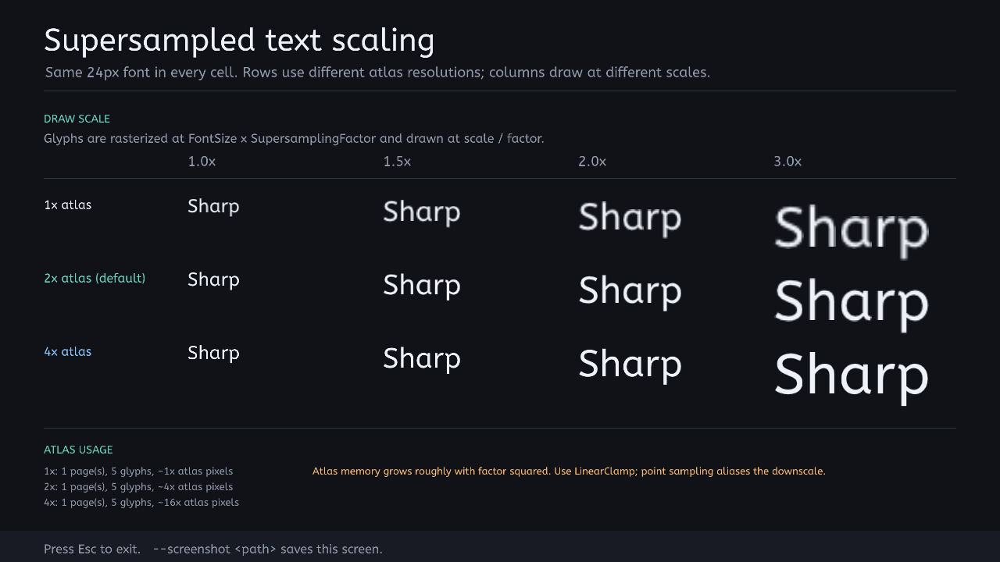

# Supersampling

[A bitmap glyph atlas](architecture.md) can only look as sharp as its texture resolution.
When `SpriteBatch` draws a glyph larger than the bitmap that was rasterized for it, it magnifies
texels and the edges soften. Supersampling fixes that by rasterizing glyphs at a higher resolution and
drawing them at an inverse scale.



## How it works

`FontSystemSettings.SupersamplingFactor` controls the multiplier:

```csharp
var fonts = new FontSystem(new FontSystemSettings
{
    SupersamplingFactor = 2f, // 1 disables supersampling
});
```

For a glyph at `FontSize = 24` and a factor of `2`:

- the bitmap is rasterized at `24 * 2 = 48 px`;
- the glyph's ink offsets are divided by `2` before layout;
- the atlas source rectangle remains the 48 px bitmap;
- drawing uses `requestedScale / 2`.

The nominal font metrics never change: advances, kerning, ascent, descent, line gap, and
`MeasureString` are all based on the requested `FontSize`. Only the glyph texture resolution and the
final draw scale are affected.

## What it improves

| Situation | Factor 1 | Factor 2 |
| --- | --- | --- |
| Text drawn at 1× | Native resolution | Slight downsample; often a little smoother |
| Text scaled to 1.5× | Magnified texels | Near 1:1 texels |
| Text scaled to 2× | Clearly soft | Near 1:1 texels |
| Text scaled to 4× | Very soft | Upscaled from 2× resolution |
| Atlas pixels used | 1× | ~4× |

A factor of 2 is the default because it covers common UI/camera scaling without a large memory
increase. Use 3–4 for heavy camera zoom, or set it to 1 when text is always drawn at its native size.

## Choosing a factor

Supersampling is not free: glyph area, and therefore atlas usage, grows approximately with the square
of the factor.

| Factor | Approximate glyph pixels |
| --- | --- |
| 1× | 1× |
| 2× | 4× |
| 3× | 9× |
| 4× | 16× |

If increasing the factor causes the atlas to hit `MaxTextureCount`, either increase the page size /
page count, reduce the number of distinct font sizes, or lower the factor. The sample prints atlas page
and glyph counts for each factor.

A fixed factor is used because `SpriteBatch` can also scale text through a transform matrix, which the
text renderer cannot observe. Pick a factor at least as large as the maximum expected on-screen scale.
If text is drawn beyond the factor, it still works but softens again; request a larger font size for
extreme zoom.

## Drawing and sampling

- Use `SamplerState.LinearClamp` (the `SpriteBatch.Begin` default). Point sampling will alias the
  downscaled glyph atlas.
- Rotation, origin, non-uniform scale, flips, and layer depth are supported. The library divides the
  draw scale by the supersampling factor while keeping layout coordinates logical.
- The factor is fixed for a `FontSystem`; changing it means creating a new `FontSystem`.
- Measurement does not allocate glyph atlases, with or without supersampling; the atlas is created
  from the first renderer/SpriteBatch device.

## On-demand behavior

Supersampling does not change when glyphs are rasterized:

- `MeasureString` remains CPU-only.
- The first draw of a code point rasterizes the supersampled bitmap.
- `PreloadGlyphs` populates the supersampled atlas ahead of time.
- `GlyphCount` still counts glyphs, not bitmap pixels.

## Sample

`Samples/Supersampling` draws the same 24 px font with 1×, 2×, and 4× atlases at 1.0×, 1.5×, 2.0×, and
3.0× display scales. The rows and columns make the tradeoff visible immediately.

```bash
dotnet run --project Samples/Supersampling
dotnet run --project Samples/Supersampling -- --screenshot supersampling.png
```

The sample also prints atlas page and glyph counts per factor. Press `Esc` to exit.

## Tests

`SupersamplingTests` verifies that:

- a 2× factor produces roughly twice the bitmap width and height;
- measurement and vertical metrics are unchanged;
- preloading still counts unique glyphs, independent of the factor;
- the configured factor is exposed by `DynamicSpriteFont`.

See [Getting started](getting-started.md) for the general API, [Samples](samples.md) for the comparison
sample, and [Architecture](architecture.md) for the rasterization pipeline.
