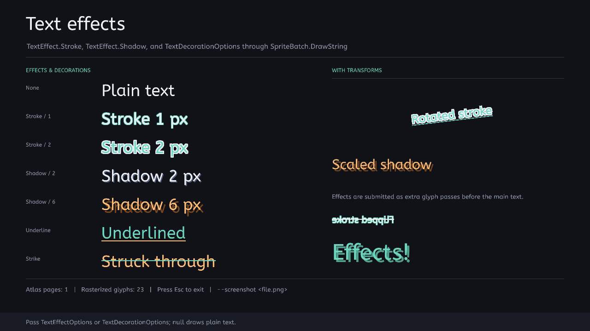

# Text effects

FontStashSharp2 can draw stroked and shadowed text through the optional `TextEffectOptions?` argument
on every draw method. Underlines and strikethroughs use a separate `TextDecorationOptions?` argument.
`null` means no effect or decoration.



## API

```csharp
public enum TextEffect
{
    Stroke = 1,
    Shadow = 2,
}

public readonly struct TextEffectOptions
{
    public TextEffectOptions(TextEffect effect, int amount = 1, Color? color = null);

    public TextEffect Effect { get; }
    public int Amount { get; }
    public Color Color { get; }

    public static TextEffectOptions Stroke(int amount = 1, Color? color = null);
    public static TextEffectOptions Shadow(int amount = 1, Color? color = null);
}
```

`Amount` is the thickness or offset in layout pixels. `Color` defaults to white when omitted.

## Drawing

MonoGame:

```csharp
spriteBatch.DrawString(
    font,
    "Outlined",
    new Vector2(40f, 80f),
    Color.White,
    effect: TextEffectOptions.Stroke(2, Color.Black));

spriteBatch.DrawString(
    font,
    "Shadowed",
    new Vector2(40f, 140f),
    Color.White,
    effect: TextEffectOptions.Shadow(4, new Color(80, 90, 120)));
```

Custom renderers and the platform-agnostic build use the same argument:

```csharp
font.DrawText(
    renderer,
    "Outlined",
    new Vector2(40f, 80f),
    Color.White,
    effect: TextEffectOptions.Stroke(2, Color.Black));
```

No effect is the default:

```csharp
font.DrawText(renderer, "Plain text", position, Color.White);
```

`TextEffectOptions` with `Amount = 0` also draws without an effect. Negative amounts and invalid effect
kinds throw `ArgumentOutOfRangeException`.

## Text decorations

Underlines and strikethroughs use a separate optional `TextDecorationOptions?` argument. It is
independent of `TextEffectOptions`, so a draw can use a decoration, an effect, both, or neither.

```csharp
public enum TextDecoration
{
    None = 0,
    Underline = 1,
    Strikethrough = 2,
}

public readonly struct TextDecorationOptions
{
    public TextDecorationOptions(
        TextDecoration decoration,
        float decorationWidth = 1f,
        Color? color = null);

    public TextDecoration Decoration { get; }
    public float DecorationWidth { get; }
    public Color? Color { get; }

    public static TextDecorationOptions Underline(float width = 1f, Color? color = null);
    public static TextDecorationOptions Strikethrough(float width = 1f, Color? color = null);
}
```

`DecorationWidth` is the line thickness in layout pixels and is scaled with the draw. `Color`
defaults to `null`, which means the line uses the main text color; pass a color to give the
decoration its own color.

MonoGame:

```csharp
spriteBatch.DrawString(
    font,
    "Underlined",
    new Vector2(40f, 200f),
    Color.White,
    decoration: TextDecorationOptions.Underline(2f));

spriteBatch.DrawString(
    font,
    "Struck through",
    new Vector2(40f, 260f),
    Color.White,
    decoration: TextDecorationOptions.Strikethrough(1.5f, Color.OrangeRed));
```

Custom renderers and the platform-agnostic build use the same argument:

```csharp
font.DrawText(
    renderer,
    "Underlined",
    new Vector2(40f, 200f),
    Color.White,
    decoration: TextDecorationOptions.Underline(2f));
```

- `null` or `TextDecoration.None` draws no decoration.
- One line is drawn per non-empty text line; line breaks are respected.
- `Color` defaults to `null`, which follows the main text color.
- Decorations follow the same rotation, scale, origin, and `SpriteEffects` flips as the glyphs.
- Decoration quads are submitted after the effect and main text passes, using the atlas's dedicated
  1x1 white texture.

Invalid decoration kinds and negative or non-finite widths throw `ArgumentOutOfRangeException`.

## How effects are drawn

Effects are draw-time passes over the same atlas glyphs; the glyph bitmap and measured metrics are
unchanged.

- **Stroke** submits the glyph at every square-ring offset up to `Amount`. `Amount = 1` produces 8
  outline passes; `Amount = N` produces `(2N + 1)² - 1` passes.
- **Shadow** submits one glyph at `(Amount, Amount)`.
- Effect passes are submitted before the main text pass, so effect pixels do not cover later glyphs.
- Offsets are in layout space, so rotation and scale transform the effect together with the text.
  `SpriteEffects` flips are applied to the glyph first, then the effect offset is added.
- `Color` is applied to the effect passes exactly as supplied. Use a contrasting color (and alpha, if
  desired) for the look you want.

Because stroke and shadow redraw glyphs, they increase draw submissions. Prefer small amounts for
dynamic text; reserve large strokes for titles and static UI.

## Samples

- [Text effects sample](samples.md#text-effects-desktopgl) demonstrates the MonoGame `SpriteBatch`
  overloads with multiple amounts, colors, rotations, scaling, and flips.
- The [OpenTK](samples.md#opentk-platform-agnostic) and
  [Silk.NET](samples.md#silknet-platform-agnostic) samples demonstrate the same effects through
  `IFontStashRenderer`.
