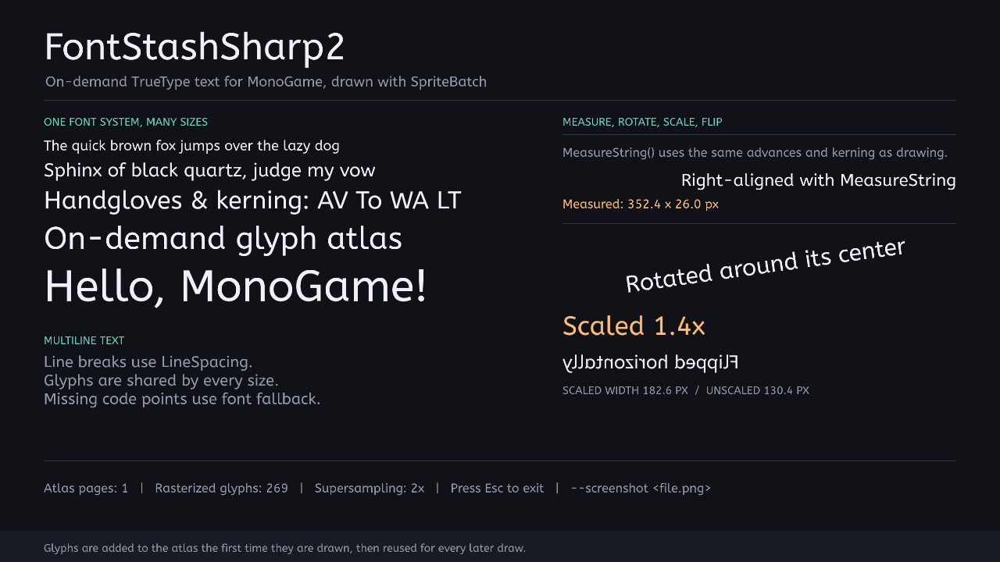

# FontStashSharp2

**On-demand TrueType text rendering for MonoGame, drawn through `SpriteBatch`.**

FontStashSharp2 loads `.ttf`/`.otf` files at runtime with
[StbTrueTypeNext](https://www.nuget.org/packages/StbTrueTypeNext), rasterizes each glyph the first time
it is needed, and caches it in a shared texture atlas. Draw calls are `SpriteBatch` extension methods
whose signatures mirror the built-in `SpriteFont` overloads.



```csharp
using var fonts = new FontSystem(GraphicsDevice);
fonts.AddFont(File.ReadAllBytes("Content/MyFont.ttf"));
var font = fonts.GetFont(32f);

spriteBatch.Begin();
spriteBatch.DrawString(font, "Hello, MonoGame!", new Vector2(40, 40), Color.White);
spriteBatch.End();
```

## Highlights

- **Runtime fonts, no content pipeline.** Ship a TTF and load it directly.
- **Truly on demand.** Measurement is CPU-only; a glyph enters the atlas only when drawn or preloaded.
- **Shared atlas.** Many sizes and fallback fonts use the same lazily grown pages.
- **SpriteBatch compatible.** Rotation, origin, uniform/non-uniform scale, effects, layer depth, and
  `StringBuilder` overloads.
- **Real font metrics.** Em sizing, vertical metrics, advances, kerning, UTF-16/surrogate handling,
  fallback by code point, and lines.
- **Measurement without a GPU.** `new FontSystem()` supports server-side/background measurement.

## Start here

- [Getting started](articles/getting-started.md)
- [Supersampling](articles/supersampling.md)
- [Architecture and invariants](articles/architecture.md)
- [Samples](articles/samples.md)
- [API reference](xref:FontStashSharp2)

## Requirements

.NET 8, C# 12, MonoGame 3.8.6.1, and StbTrueTypeNext 1.0.3.

## Limitations

FontStashSharp2 does not implement complex shaping (Arabic/Indic joining, bidi, ligature
substitution), color emoji, or variable-font axes. Tabs advance like a single space. See the
repository's `README.md` for the full behavior notes.
